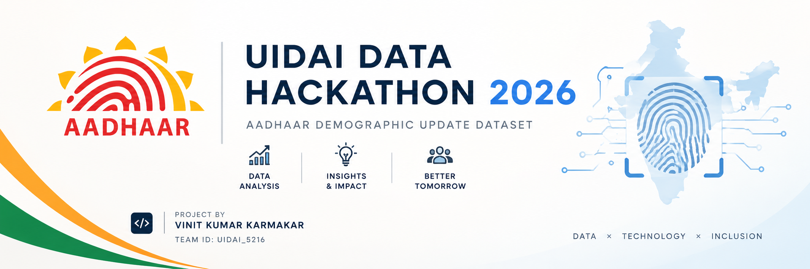

<p align="center">
  
</p>

### **Project Overview**

This project focuses on the large-scale analysis of Aadhaar update trends across India. By applying advanced data cleaning and demographic profiling, we identified a massive **22.89% duplication rate** in raw data. The goal is to transition the current reactive update system into a proactive, **"Child-First"** policy framework that maximizes Government ROI.

---

### **Key Impact & Data Audit (Post-Cleaning)**

The data cleaning process was critical in identifying system inefficiencies:

* **Duplicate Elimination**: Successfully identified and purged **474,307 duplicate records**, representing **22.89%** of the raw dataset.
* **Database Optimization**: Reduced total population count by **25.8% (-1.26 Crore records)**, ensuring a verified unique user base.
* **Refined Demographics**: Corrected the **Youth-to-Child ratio from 9.14:1 to 10.90:1**, highlighting a dominant Adult (90.17%) update volume.
* **Entity Efficiency**: Achieved a **44.6% reduction** in unique entities, streamlining the reporting architecture.

---

### **Tech Stack**

* **Language**: Python (Pandas, Matplotlib, Seaborn)
* **Analysis**: Geographic Mapping, De-duplication Algorithms, Demographic Profiling

---
### **Project Directory Structure**

```text
UIDAI-HACKATHON-PROJECT-2026/
├── Data/
│   ├── raw/            # Unprocessed data (49.2M records)
│   └── processed/      # Cleaned data (36.5M records)
├── notebooks/          # Jupyter notebooks for exploratory analysis
├── visuals/            # Exported PNGs (Charts & Dashboards)
├── README.md           # Project documentation
└── requirements.txt    # Python dependencies

```

### **Final Project Checklist**

* **Data Cleaning**: Handled **4.7 Lakh duplicates**.
* **Demographic Split**: Validated **90.2% Adult** vs **9.8% Child** ratio.
* **Priority Mapping**: Identified **Top 10 Districts** for infrastructure upgrades.
* **Policy Strategy**: Included the **"Child-First"** recommendation for 5 & 15-year biometric milestones.
